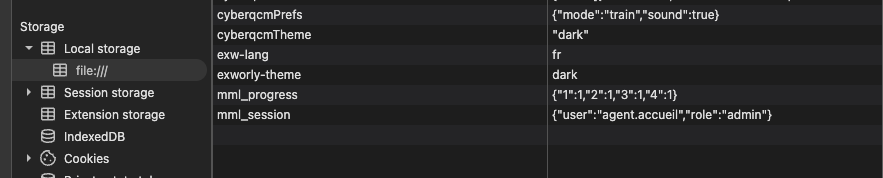
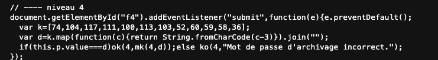

# Write-up : MML Intranet

> ⚠️ **SPOILERS** : ce document contient toutes les solutions. Essaie d'abord le challenge par toi-même !

## Introduction

L'intranet fictif de la Mutuelle des Monts du Lyonnais propose 5 services internes, chacun protégé par une vérification. Objectif : récupérer les 5 drapeaux.

**Outils utilisés** : DevTools du navigateur (code source, console JavaScript, onglet Application / Local Storage, inspecteur d'éléments).

---

## Niveau 1 : Messagerie

**Observation.** En inspectant le code source de la page, on trouve un commentaire HTML laissé par un développeur, destiné à Kévin :

```html
<!-- TODO (Kévin) : supprimer le compte de test avant mise en prod -> jmartin / Printemps2019 -->
```

Le compte de test n'a jamais été supprimé : l'identifiant et le mot de passe sont en clair dans le code envoyé au navigateur.

**Exploitation.** Connexion avec `jmartin` / `Printemps2019`.

**Faille** : informations sensibles dans les commentaires (CWE-615).
**Correction** : retirer les commentaires et les comptes de test avant la mise en production.

🚩 `MML{2b4992e5adc6fc69}`

---

## Niveau 2 : Paie

**Observation.** Le service paie demande un code d'accès réservé au service RH. En fin de code source, on trouve le script qui vérifie ce code :

```js
document.getElementById("f2").addEventListener("submit", function(e){
  e.preventDefault();
  var cfg = {service:"paie", version:"2.3.1", code:"Qm9iYnlfVGFibGVzNDI="};
  if (this.p.value === atob(cfg.code)) ok(2, mk(2, this.p.value));
  else ko(2, "Code d'accès invalide.");
});
```

Le code saisi est comparé à `atob(cfg.code)`. La fonction `atob()` décode du **Base64**, et le `=` final de la chaîne est un indice typique de cet encodage.

**Fausse piste.** J'ai d'abord cherché `cfg` dans le stockage du navigateur. En réalité, c'est une variable locale, qui n'existe que pendant la vérification du formulaire.

**Exploitation.** Je recrée la variable dans la console, puis je la décode :

```js
var cfg = {service:"paie", version:"2.3.1", code:"Qm9iYnlfVGFibGVzNDI="};
atob(cfg.code)
// 'Bobby_Tables42'
```

Le code d'accès est `Bobby_Tables42`.

**Faille** : secret stocké côté client, en Base64. Le Base64 est un **encodage**, pas un chiffrement : il se décode instantanément, sans clé.
**Correction** : vérifier le code côté serveur, ne jamais l'envoyer au navigateur.

🚩 `MML{b9e4372b51d0b87}`

---

## Niveau 3 : Administration

**Observation.** Dans le code source, l'accès au panneau dépend du rôle de la session :

```js
if (s.role === "admin") ...
```

La session `s` est lue depuis le stockage du navigateur avec `store.get("mml_session")`. Il faut donc passer sous le rôle `admin`.

**Fausse piste.** Taper `s.role = "admin"` ou `role = "admin"` dans la console ne fonctionne pas : ces variables sont temporaires, alors que la page relit la session dans le Local Storage à chaque clic.

**Exploitation.** Dans les DevTools : **Application** > **Local Storage**, je modifie la clé `mml_session` en remplaçant `"role":"agent"` par `"role":"admin"`, puis je clique à nouveau sur le bouton.



**Faille** : Broken Access Control (OWASP A01). L'application fait confiance à une donnée que l'utilisateur contrôle.
**Correction** : gérer les rôles et les droits côté serveur, jamais dans le stockage du navigateur.

🚩 `MML{50d07086e6eca8ea}`

---

## Niveau 4 : Archives

**Observation.** Le script de vérification contient deux variables :



```js
var k = [74,104,117,111,100,113,103,52,60,59,58,36];
var d = k.map(function(c){ return String.fromCharCode(c-3) }).join("");
```

- `k` est un tableau de codes de caractères.
- `String.fromCharCode(c-3)` retire 3 à chaque code puis le transforme en caractère.
- `.join("")` recolle les caractères en une seule chaîne.

C'est un **chiffre de César** (*Caesar cipher*) avec un décalage de 3.

**Exploitation.** Comme pour `cfg`, ces variables sont locales. Je les recrée dans la console, puis j'affiche `d` :

```js
var k = [74,104,117,111,100,113,103,52,60,59,58,36];
var d = k.map(function(c){ return String.fromCharCode(c-3) }).join("");
d
// 'Gerland1987!'
```

Le mot de passe décodé est `Gerland1987!`.

**Faille** : obfuscation faible. Un décalage de caractères ne protège rien, puisque la méthode de décodage est fournie avec le secret.
**Correction** : vérifier le mot de passe côté serveur.

🚩 `MML{81a43f7c851848f0}`

---

## Niveau 5 : Coffre numérique

**Observation.** Le coffre est scellé et ne peut s'ouvrir qu'à la date programmée par la direction : le 1er janvier 2000. Le bouton d'ouverture est en plus désactivé. Dans le script :

```js
window.horlogeServeur = function(){ return new Date() };
function coffre(){
  var d = window.horlogeServeur();
  ...
}
```

Malgré son nom, `horlogeServeur` lit simplement la date de mon ordinateur. Et comme elle est attachée à `window`, elle est accessible et modifiable depuis la console.

**Exploitation, en deux étapes.**

1. **Faire croire à la page qu'on est le 1er janvier 2000**, en remplaçant la fonction :

```js
window.horlogeServeur = function(){ return new Date(2000, 0, 1) }
```

> ⚠️ Piège rencontré : `return 2000-01-01` sans guillemets est un calcul (`2000 - 1 - 1 = 1998`). Il faut renvoyer un véritable objet `Date`, sinon `d.getFullYear()` plante. Et dans `new Date()`, les mois commencent à 0 (janvier = 0).

2. **Réactiver le bouton** : clic droit sur le bouton > **Inspecter**, puis suppression de l'attribut `disabled` dans le HTML.

Un clic sur le bouton ouvre le coffre.

**Faille** : confiance accordée au client. La date et l'état du bouton sont entièrement contrôlés par l'utilisateur.
**Correction** : contrôler la date et l'autorisation d'ouverture côté serveur.

🚩 `MML{f72d692e8ec4d3a2}`

---

## Conclusion

| Niveau | Faille | Correction |
|--------|--------|------------|
| 1. Messagerie | Identifiants dans un commentaire HTML | Nettoyer le code avant la mise en prod |
| 2. Paie | Secret en Base64 dans le JavaScript | Vérification côté serveur |
| 3. Administration | Rôle modifiable dans le Local Storage | Gestion des droits côté serveur |
| 4. Archives | Mot de passe obfusqué par chiffre de César | Vérification côté serveur |
| 5. Coffre numérique | Date et bouton contrôlés par le client | Contrôle côté serveur |

Les 5 failles ont la même cause racine : **tout ce qui est envoyé au navigateur peut être lu et modifié par l'utilisateur.** Une vérification de sécurité qui se fait uniquement côté client n'en est pas une.

**Ce que j'ai appris** : lire le code source d'une page, recréer des variables locales dans la console, décoder du Base64 et un chiffre de César, modifier le Local Storage, réécrire une fonction JavaScript et réactiver un élément désactivé.
